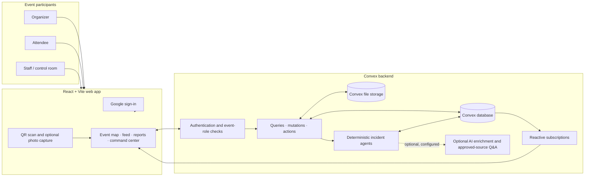
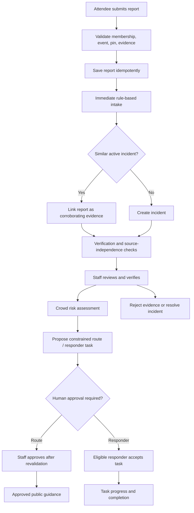

# PINPOINT

**Real-time incident reporting and operational coordination for live events.**

PINPOINT gives attendees and event staff a shared, live view of incidents on a venue map. Attendees can send a report from their phone; staff review it, verify it, and coordinate a response. Convex keeps connected clients up to date without polling or manual refresh.

**Live demo:** [eventpulse-zeta.vercel.app](https://eventpulse-zeta.vercel.app) (or [eventpulsee.netlify.app](https://eventpulsee.netlify.app))

## Why PINPOINT

At a large event, people may already see that something is wrong. What is often missing is a shared, trusted picture of what is happening and where. PINPOINT puts reports, staff decisions, venue context, and response coordination in one event-specific workspace.

An organizer creates an event and shares separate attendee and staff join codes. Attendees use the map and feed to report or follow incidents. Staff have moderation and event-operations tools, including the command center, map pins for facilities, and responder coordination. The same signed-in user can have different roles at different events.

## How it works



The browser authenticates with Convex Auth and calls typed Convex functions. Backend functions derive the user's identity and event membership on the server; the client does not get to choose its own role. Database queries stay subscribed in the browser, so a report review, status change, route approval, or telemetry update appears on other connected clients as soon as Convex commits it. Venue images and report evidence use Convex file storage.

## Report and response lifecycle



The report moderation lifecycle is `pending → approved → resolved`, with `rejected` as a terminal outcome. Incident verification is separate: reports can be grouped into an incident, then corroboration and staff attestation determine whether that incident is verified. Routing proposals and dispatch actions are also separate from report approval. A proposed evacuation route remains staff-only until an authorized staff member approves it after the backend rechecks the current venue graph and telemetry.

### Incident agents

The operations pipeline is a set of explicit, deterministic Convex functions rather than an autonomous model deciding what to do:

1. **Intake** classifies report details with conservative rules, prevents duplicate submissions, and links similar reports to a master incident.
2. **Verification** checks whether sources are eligible and independent, applies trust and hazard thresholds, and can request staff verification.
3. **Crowd intelligence** computes zone risk from recorded occupancy, inflow/outflow, and blocked-passage information.
4. **Routing** evaluates a directed venue graph, risk, passability, telemetry freshness, and capacity to create a time-limited proposal.
5. **Dispatch** reserves a qualified, available event responder and tracks task acceptance, arrival, completion, or escalation.

Staff remain responsible for physical verification, route approval, and operational decisions. The app does not contact emergency services. The visible agent pipeline can also run as a paced showcase; showcase/simulated activity is identified separately from live operation.

### Optional AI

AI features are an optional enhancement, separate from the core incident workflow. They are **off by default** and require both deployment configuration and event-level settings. When configured, a bounded workpool can send report text and registered image evidence to a provider through LangChain for schema-validated enrichment. Organizers can use **Off**, **Shadow** (record suggestions without applying them), or **Assist** (limited incident summary/severity/classification updates). AI does not verify an incident, auto-merge semantic duplicate suggestions, approve routes, or dispatch emergency services.

Organizers can also add versioned text sources such as SOPs, approve them, and let staff ask event-scoped questions that return exact source excerpts or abstain. This uses embeddings and vector search. Provider availability is not required for report intake or staff moderation; AI failures do not roll back core report handling. See [AI operations and rollout](docs/AI_OPERATIONS.md) for configuration, privacy, quotas, safeguards, and the staging release procedure.

## Features

- Google sign-in and role-based participation per event.
- Separate attendee and staff codes, plus attendee QR join and manual-code fallback.
- Organizer event setup with venue, date/time, description, and floor plan upload.
- Pin-based incident reports, optional priority and browser-captured or uploaded photo evidence.
- Staff moderation: approve, reject, resolve, prioritize, review history, and ban reporters.
- Real-time map and feed updates through Convex subscriptions.
- Responsive attendee and staff experiences, including map, feed, event information, and account views.
- Staff command center with incidents, operational agent logs, crowd zones, routes, responders, and tasks.
- Venue zones, directed route graph, egress configuration, telemetry, route approval, and responder task lifecycle.
- Points of interest on the venue map.
- Staff phone alert banner, vibration, browser notifications, and user-armed emergency sound for new incidents.
- Local theme preference, session restoration from auth/membership state, and phone camera QR scanning.

## Roles

Roles are attached to a membership in an event. The backend checks the membership on every protected operation.

| Role | Typical capabilities |
| --- | --- |
| **Organizer** | Create and configure events, upload a floor plan, manage membership, and use staff capabilities. |
| **Staff** | Review and resolve reports, configure map POIs and operations data, manage responders, and approve operational routes. |
| **Attendee** | View the event map and public feed, submit reports, and view their own reporting history. |

## Technology

| Area | Technology |
| --- | --- |
| Frontend | React 19, TypeScript, Vite 8, Tailwind CSS 4 |
| Backend | Convex queries, mutations, actions, scheduled functions, and reactive subscriptions |
| Authentication | Convex Auth with Google OAuth |
| File handling | Convex file storage; `jsQR` for in-browser QR decoding |
| Optional AI | LangChain provider adapters, structured output, bounded workpool, and Convex vector search |
| Tests and checks | Vitest, `convex-test`, Edge Runtime VM, TypeScript, Oxlint |
| Hosting | Netlify frontend build with Convex deployment during the production build |

There is no separate REST server. The Vite client calls Convex directly through generated, typed function references.

## Run locally

### Prerequisites

- Node.js 22 (recommended for local Convex backend and CI; Node 24 is also supported by the backend operations guide).
- npm.
- A Convex account/deployment for backend development.
- Google OAuth credentials if you want to test sign-in.

### Start the app

```bash
npm install
npx convex dev       # terminal 1: start/deploy the development backend
npm run dev          # terminal 2: start Vite
```

Open [http://localhost:5173](http://localhost:5173). `npx convex dev` creates or updates the local `.env.local` values used by the frontend. The app expects `VITE_CONVEX_URL`; `VITE_CONVEX_SITE_URL` is also used for the Convex HTTP site host in deployment/auth setup.

### Google OAuth setup

Configure the Google provider on the Convex development deployment:

```bash
npx @convex-dev/auth
npx convex env set SITE_URL "http://localhost:5173"
npx convex env set AUTH_GOOGLE_ID "<google oauth client id>"
npx convex env set AUTH_GOOGLE_SECRET "<google oauth client secret>"
```

In Google Cloud Console, create an OAuth 2.0 Client ID for a **Web application** and configure:

| Google setting | Development value |
| --- | --- |
| Authorized JavaScript origin | `http://localhost:5173` |
| Authorized redirect URI | `https://<your-deployment>.convex.site/api/auth/callback/google` |

Add the deployed website origin and its corresponding Convex callback when configuring production. `.convex.cloud` is the Convex data endpoint; `.convex.site` serves HTTP actions and the OAuth callback.

### QR scanning and camera access

Camera QR scanning requires a secure browser context. It works on the HTTPS deployment and generally does not work when a phone visits a development server over plain HTTP. On desktop, upload a QR image or enter a code manually. Browser audio and notifications also require user permission or a user gesture on many mobile browsers.

## Environment and secrets

Frontend values are public deployment URLs only:

```dotenv
VITE_CONVEX_URL=https://<your-deployment>.convex.cloud
VITE_CONVEX_SITE_URL=https://<your-deployment>.convex.site
```

Set these with the Convex CLI for the target deployment; do not place provider secrets in `VITE_*` variables or browser code:

```bash
npx convex env set SITE_URL "https://<your-site-origin>"
npx convex env set AUTH_GOOGLE_ID "<google oauth client id>"
npx convex env set AUTH_GOOGLE_SECRET "<google oauth client secret>"
```

Optional AI deployment variables are described in [AI operations and rollout](docs/AI_OPERATIONS.md). In brief: `PINPOINT_AI_ENABLED` (or `EVENTPULSE_AI_ENABLED`) must be exactly `true` to allow configured provider work, and provider credentials/model names belong only in the Convex deployment environment. AI is not needed to run the core app.

## Build, test, and lint

```bash
npm run build              # TypeScript project build + optimized Vite bundle
npm test                   # Vitest suite
npm run lint               # Oxlint
npm run typecheck:backend  # Typecheck Convex backend
```

Other useful scripts:

| Command | Purpose |
| --- | --- |
| `npm run dev` | Run the Vite development server. |
| `npm run preview` | Preview the production bundle locally. |

The backend tests use `convex-test` and the Edge Runtime VM. Automated tests are useful for function contracts but do not replace an authenticated browser smoke test against a staging deployment, provider evaluation, or venue safety validation.

## Deploy

The Netlify build in [`netlify.toml`](netlify.toml) runs:

```bash
npx convex deploy --cmd 'npm run build'
```

This deploys Convex functions to the production deployment selected by `CONVEX_DEPLOY_KEY`, then builds the frontend with the production Convex URLs injected by the Convex CLI. Netlify publishes `dist/`; its SPA fallback serves the app for all paths. Configure the Convex deploy key and the appropriate Google OAuth environment on the target deployments before production release. The frontend and backend should be released as a compatible pair.

For AI-enabled releases, follow the full staging and rollout checklist in [docs/AI_OPERATIONS.md](docs/AI_OPERATIONS.md). The current AI implementation has local tests and checks, but the operational guide calls for staging validation before production activation.

## Architecture and implementation notes

### Client state and live data

`src/App.tsx` owns the main screen flows and subscribes to Convex queries. Authentication and memberships determine the active event and role; they are not trusted from a stale client-side role flag. `src/main.tsx` initializes Convex Auth, the Convex client, and the top-level error boundary. Convex queries are reactive, so there is no polling loop to keep maps and feeds synchronized.

### Authorization and data model

`convex/schema.ts` defines the application data model and indexes. Convex Auth owns its auth tables. Core app records include:

| Data | Purpose |
| --- | --- |
| `events` | Event metadata, join codes, active state, and floor-map storage reference. |
| `memberships` | User's role, ban state, trust score, and event membership. |
| `reports` | Attendee-submitted report, map coordinates, moderation state, and evidence reference. |
| `mapPins` | Staff-created facilities/points of interest. |
| `incidents`, `incidentReports` | Deduplicated operational incidents and links to their source reports. |
| `zones`, `venueEdges` | Venue layout, live telemetry, and directed routing graph. |
| `routeRecommendations` | Expiring route proposals and staff approval state. |
| `responders`, `dispatchTasks` | Staff responder capabilities/availability and incident assignments. |
| `agentLogs`, `pipelineRuns` | Operational decision audit and visual pipeline progress. |
| `aiSettings`, `aiAnalyses`, knowledge tables | Event-scoped optional AI controls, analysis results, and approved source material. |

Every protected backend function derives the signed-in user with Convex Auth and checks event membership and role through `convex/lib/authz.ts`. Sensitive actions use internal Convex functions; client-facing API functions are deliberately separated from internal workflow steps.

### Coordinates and maps

Report, POI, zone, and responder display positions use percentages (`0`–`100`) relative to the floor-plan image rather than screen pixels. This makes persisted pins independent of viewport dimensions. The bundled campus map has measured zone names in `convex/lib/geo.ts`; those labels are only used with that matching bundled map. Uploaded venue maps use neutral location text rather than reusing campus-specific geometry.

### Reliability and safety rules

- **Idempotent reports:** each submission includes a client-generated ID so a retry after a weak connection does not create a duplicate.
- **Legal transitions:** report and responder-task state changes are checked by backend logic.
- **One live-report rule:** public map/feed surfaces share the same approved, not-banned, unresolved predicate.
- **Server-side role checks:** hiding a control in the UI is not treated as authorization.
- **Human approval:** route proposals are time-limited and revalidated before public guidance; staff own the decision.
- **Optional-provider isolation:** core report intake and moderation remain available if AI is disabled or a provider fails.

## Repository layout

```text
src/
  App.tsx                    Main app screens, navigation, and client workflows
  main.tsx                   React entry point, Convex/Auth providers, error boundary
  index.css                  Design tokens, theme, responsive styles
  AgentCommandCenter.tsx     Staff operational command center
  AgentPipelineVisualizer.tsx Pipeline run visualization
  ResponderRoster.tsx        Responder roster UI
  ZoneTelemetryEditor.tsx   Venue zone and telemetry editing UI
  AIWorkspace.tsx            Optional AI operations and knowledge UI
  imports/                   Map and other bundled image assets

convex/
  schema.ts                  Database tables, validators, indexes
  events.ts                  Event create, join, update, and lifecycle operations
  memberships.ts             Event memberships and staff/attendee management
  reports.ts                 Report creation, queries, moderation, and priority
  files.ts                   Convex upload URL and evidence registration helpers
  mapPins.ts                 Venue POIs
  telemetry.ts               Zone telemetry and egress settings
  responders.ts              Responder registration and availability
  orchestrator.ts             Live report-to-operations workflow entry points
  agentPipeline.ts            Staged pipeline/showcase execution and progress
  agents/                    Intake, verification, crowd, routing, dispatch, queries
  ai/                        Optional provider, analysis, RAG, and policy modules
  lib/                       Authorization, routing, safety, time, geo, and policy helpers
  _generated/                Convex-generated API and data model bindings

docs/
  AI_OPERATIONS.md            AI architecture, configuration, privacy, release checklist
  BOUNDED_AI_TRIAGE_IMPLEMENTATION_REPORT.md
```

## Known limitations and operational boundaries

- Named campus zones only apply to the bundled campus map. Uploaded floor plans need their own zone configuration for meaningful zone labels and operational routing.
- A usable floor plan is part of organizer event setup.
- Staff join by staff code; attendee QR codes are not the staff join flow.
- Trust and verification policy is implemented in the backend, but operational thresholds and venue telemetry still need real-world validation.
- Route distances and ETAs are estimates based on configured graph values, not surveyed movement times. Capacity and throughput values must be set and verified by the event operator.
- Staff phone alerts require the page/app to remain open and browser permissions to be enabled; audio must be armed by a user gesture.
- The backend has no external emergency-services dispatch integration. Responder tasks are for the event's registered staff.
- Optional AI uses provider infrastructure when enabled. Review data handling, retention, and model behavior before sending real attendee text or image evidence. AI analysis is advisory and does not replace staff judgment.
- Features that imply verified conditions, emergency dispatch, precise positioning, continuous video analysis, or guaranteed delivery are not provided by this app.

## More information

- [AI operations and rollout](docs/AI_OPERATIONS.md) — AI controls, provider configuration, source-based Q&A, privacy, quotas, and production staging.
- [Implementation report](docs/BOUNDED_AI_TRIAGE_IMPLEMENTATION_REPORT.md) — bounded AI triage implementation details.

---

**Team EXO**
